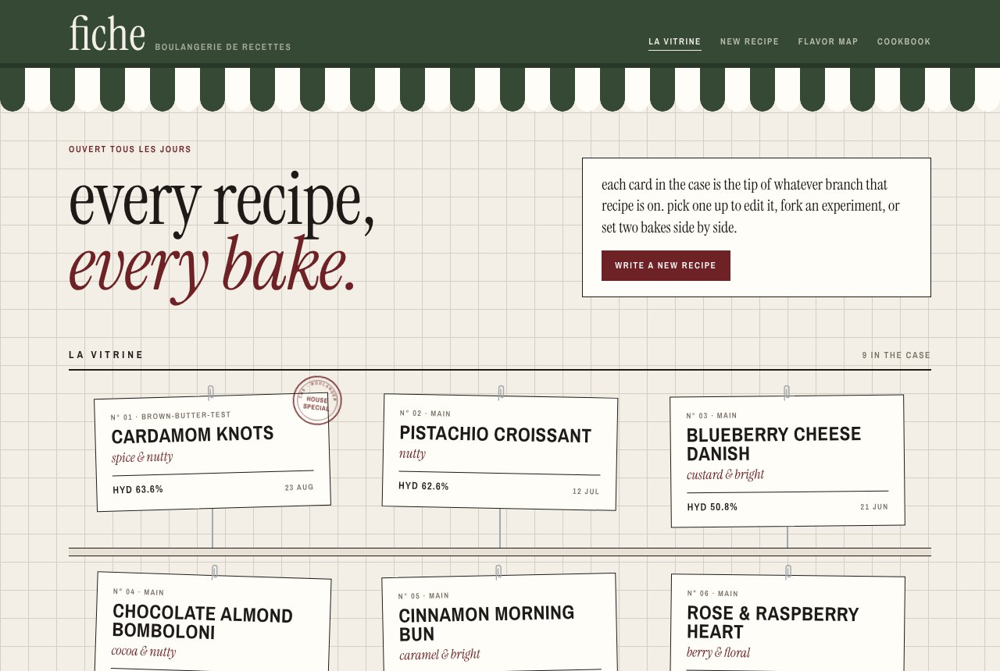
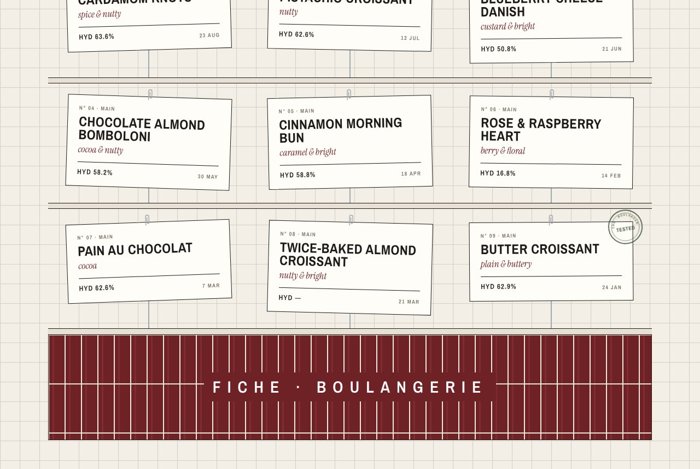
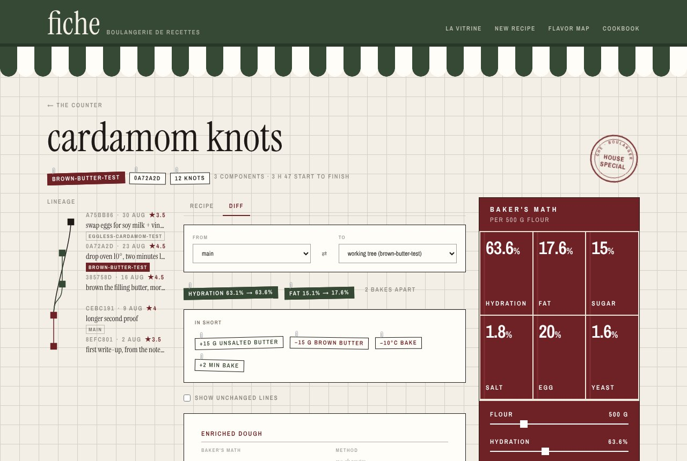
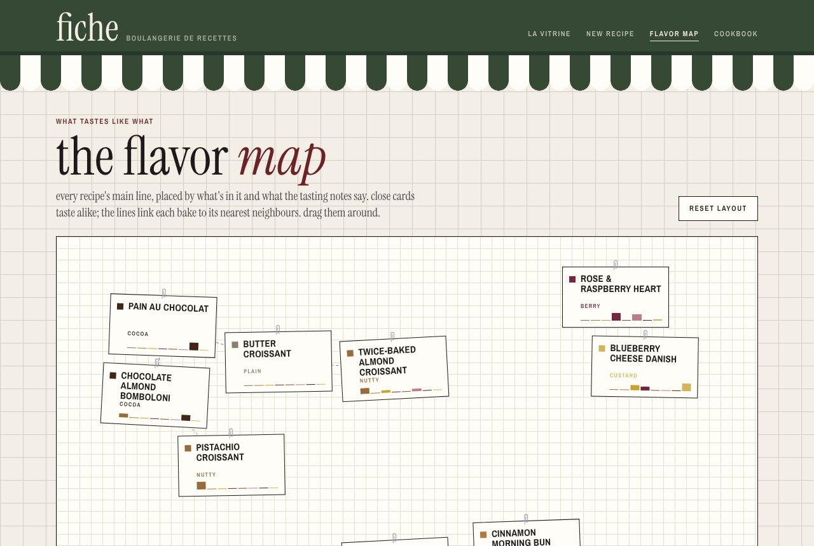

# fiche

recipes under version control.

every recipe in fiche is a tree, not a page of text: components (dough, filling, glaze), ingredients in grams, steps with times and temperatures. that means i can branch a recipe to try something, diff two bakes and see `+15 g brown butter, −10°C bake` instead of a wall of red and green lines, and lift a pastry cream out of one recipe into another.

it started because my notebook had four versions of the same cardamom bun and i couldn't remember which one had the longer proof.



## what it does

- **ingest.** paste a recipe or a link. cups and spoons become grams using a density table, and every ingredient gets a baker's percentage. for links it reads the page's schema.org recipe data first, so it skips the life story. anything it can't convert gets flagged instead of guessed.
- **baker's math.** hydration, fat, sugar, salt and egg as percentages of total flour. the flour slider scales the whole recipe, and the hydration slider only moves water and milk.
- **guardrails.** small warnings for the things i keep relearning: salt outside 1.8–2.2% in a yeasted dough, sugar high enough to slow regular yeast, proofing laminated dough warm enough to melt the butter.
- **branches + commits.** fork an experiment (`eggless-test`, `brown-butter-test`), edit, then commit with a crumb score and tasting notes. commits are content-hashed. merge fast-forwards when it can.
- **semantic diff.** ingredients and components are matched by id, then by name, so a rename shows as a rename and a change in grams shows as a delta.
- **cherry-pick.** graft one component from any commit of any recipe into the working tree. it remembers where it came from.
- **flavor map.** each recipe's main line becomes a small vector: eight flavor axes (nutty, caramel, bright, berry, spice, floral, cocoa, custard) scored from ingredients and tasting notes, plus structural ratios. it's projected to 2D with pca and laid out on a butcher block. drag things around.
- **cookbook.** takes the tip of `main` from every recipe and sets it as an a5 book. you can print it straight from the browser or export typst source, and the worker compiles that into a real pdf.





## running it

```bash
npm install
npm run dev
```

open http://localhost:3000. the first load seeds nine recipes from my notebook so there's something to look at. signed out, everything lives in localStorage. export, import and reset are on the cookbook page.

```bash
npm test          # engine tests (vitest)
npm run typecheck
npm run lint
```

### the worker (optional)

the python worker does two things: unit normalization with `pint`, and typst → pdf.

```bash
cd worker
python -m venv .venv && source .venv/bin/activate
pip install -r requirements.txt
uvicorn main:app --port 8000
```

then set `FICHE_WORKER_URL=http://localhost:8000` in `.env.local`, and the cookbook page's "typeset pdf" button will work. without it you can still download the `.typ` and run `typst compile --font-path public/fonts cookbook.typ` yourself.

### supabase

sign in and the library syncs to postgres. without the env vars below the app just stays local.

1. make a project, then run `supabase/migrations/0001_init.sql` (sql editor, or `supabase db push` with the cli)
2. in auth → url configuration, add `http://localhost:3000/account` to the redirect urls
3. put the project url and anon key in `.env.local`:

```bash
NEXT_PUBLIC_SUPABASE_URL=https://<project>.supabase.co
NEXT_PUBLIC_SUPABASE_ANON_KEY=<anon key>
```

sign-in is an emailed magic link (`/account`). the first time you sign in to an empty account, whatever is on the device gets uploaded. after that supabase is the source of truth and edits are pushed per recipe, a moment after you stop typing.

the schema: `repositories`, `commits` (recipe as jsonb, tasting notes, and a `vector(12)` flavor embedding with an hnsw index), `commit_parents` (merge commits have two), and `branches`. commits are content-addressed, so a push only inserts hashes the database hasn't seen. every table has row level security scoped to `auth.uid()`, and `similar_bakes(vector)` returns your nearest bakes by flavor.



## layout

```
src/lib/
  ast.ts       zod schema for recipes, commits, repos
  math.ts      baker's percentages, scaling, hydration, guardrails
  density.ts   grams-per-cup + water content table
  units.ts     quantity parsing, unit conversion
  ingest.ts    text / json-ld → recipe
  repo.ts      commit, branch, checkout, merge, cherry-pick, dag layout
  diff.ts      semantic diff
  flavor.ts    flavor vectors, pca, neighbours
  typst.ts     cookbook → typst source
  seed.ts      starter library
  store.tsx    library state, local cache + supabase sync
  sync.ts      repo <-> table rows, push / pull
src/app/       counter, workbench (/r/[slug]), new, graph, cookbook, account, api routes
worker/        fastapi: /normalize, /compile
supabase/      schema
```

## stack

next.js (app router) · react · typescript · tailwind · framer motion · zod · supabase · vitest
python worker: fastapi · pint · typst

## look

a corner bakery in paris, flattened: cream ceramic tile with 1px grout behind everything, a scalloped green-and-cream awning under the sign, recipes as hand-lettered price cards on wire clips standing on a ledge above an oxblood subway-tile counter. no gradients, no shadows, no rounded corners. the baker's math is set in white on its own block of oxblood tile.

## fonts

- **instrument serif** for display and body
- **archivo narrow** for labels, flags and numbers

both are ofl. the files and licenses are in `public/fonts`, and the typst export uses the same two.

## next up

- use `similar_bakes` for the flavor map when signed in
- photos on commits
- three-way merge that asks per component instead of taking theirs
- better ingest for the formats blogs actually use (ranges like "1–1½ cups", "1 cup + 2 tbsp")
